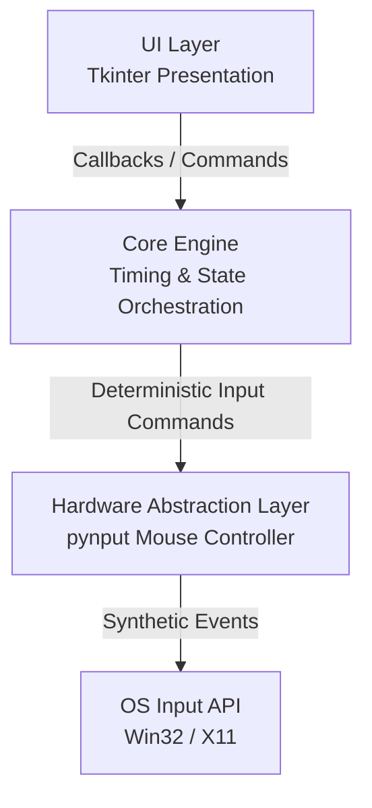

# PrecisionClick ⚡

> High-Precision Desktop Automation Engine — a modular Python system for millisecond-accurate mouse automation, built with SOLID principles, strict Separation of Concerns, thread-safe UI orchestration, and a hybrid Sleep/Spin timing strategy designed to bypass OS scheduler limitations.


[](https://raw.githubusercontent.com/mohammad-hussein-dev/precision-click/main/docs/PrecisionClick_Technical_Report.pdf)


---

## Table of Contents

- [Overview](#overview)
- [Technical Architecture Report](#technical-architecture-report)
- [Engineering Value](#engineering-value)
- [Architecture](#architecture)
- [Hybrid Timing Strategy](#hybrid-timing-strategy)
- [Key Features](#key-features)
- [Tech Stack](#tech-stack)
- [Installation](#installation)
- [Usage](#usage)
- [Development Workflow](#development-workflow)
- [Project Structure](#project-structure)
- [Quality Gates](#quality-gates)
- [Performance Overview](#performance-overview)
- [Security & Trust](#security--trust)
- [Contributing](#contributing)
- [License](#license)
- [Author](#author)

---

## Overview

**PrecisionClick** is not a simple auto-clicker. It is a production-minded desktop automation engine engineered to solve a real systems-level problem: achieving reliable millisecond-scale timing on general-purpose operating systems where `time.sleep()` is subject to scheduler granularity, context-switch latency, and non-deterministic wake-up behavior.

The project demonstrates advanced Python engineering across multiple layers:

- **Low-level input simulation** through a Hardware Abstraction Layer.
- **Deterministic timing orchestration** using a hybrid coarse/fine scheduling model.
- **Thread-safe GUI architecture** for Tkinter-based desktop applications.
- **Typed, maintainable, testable codebase** aligned with Clean Code and SOLID principles.
- **Reproducible CI/CD pipeline** for linting, testing, and Windows executable builds.
- **Senior-level technical documentation** delivered as a dedicated PDF architecture report.

This repository is suitable as a portfolio artifact for roles involving:

- Backend / Desktop Python Engineering
- Systems Programming Concepts
- Automation / RPA Tooling
- DevSecOps and CI/CD Practices
- Software Architecture and Code Quality Leadership

---

## Technical Architecture Report

A dedicated senior-level technical report has been prepared for this project.

[📄 Download / Open Technical Architecture Report — PDF](https://raw.githubusercontent.com/mohammad-hussein-dev/precision-click/main/docs/PrecisionClick_Technical_Report.pdf)

The report includes:

- Executive summary
- Problem statement and OS scheduler analysis
- System architecture and layer responsibilities
- Mathematical model of the hybrid timing strategy
- Concurrency and thread-safety design
- Hardware abstraction and input simulation decisions
- Security considerations
- Testing and validation methodology
- Performance benchmarking
- CI/CD deployment pipeline
- MIT licensing and legal notice

This document is intended to demonstrate engineering depth beyond implementation, showing architectural reasoning, trade-off analysis, and production-oriented documentation discipline.

---

## Engineering Value

| Area | Implementation |
|---|---|
| **Architecture** | Strict Separation of Concerns across UI, Core Engine, and Hardware Abstraction Layer |
| **Design Patterns** | Adapter, Strategy, State Machine, Observer / MVC-style callback dispatching |
| **Timing Precision** | Hybrid Sleep/Spin strategy targeting ±1–3 ms practical deviation |
| **Concurrency** | Background worker threads with `threading.Event`-based coordination |
| **UI Safety** | Tkinter updates marshalled to the main thread using `root.after()` |
| **Type Safety** | PEP 484 type hints across the codebase |
| **Maintainability** | Google-style docstrings, modular package layout, explicit error boundaries |
| **Build Pipeline** | GitHub Actions for linting and Windows PyInstaller artifact generation |
| **Documentation** | Full Technical Architecture Report in PDF format |
| **Licensing** | MIT License for maximum openness and reuse |

---

## Architecture



| Module | Responsibility | Pattern |
|---|---|---|
| `src/core/mouse.py` | Hardware Abstraction Layer wrapping `pynput` for deterministic mouse control | Adapter |
| `src/core/engine.py` | Business logic, timing orchestration, state management, hybrid wait strategy | Strategy / State Machine |
| `src/ui/main_window.py` | Tkinter presentation layer, user controls, telemetry log, thread-safe updates | MVC / Observer |
| `src/main.py` | Application entry point and lifecycle bootstrap | Facade |

---

## Hybrid Timing Strategy

Standard `time.sleep()` on Windows/Linux is limited by OS scheduler granularity, often around 15 ms. Pure busy-waiting improves precision but consumes CPU unnecessarily.

PrecisionClick uses a two-phase timing model:

```python
if remaining_ms > 2.0:
    time.sleep(remaining_ms - buffer_ms)
else:
    while datetime.now() < target_time:
        pass
```

### Phase 1 — Coarse Sleep

Used when the remaining delay is relatively large.

- Low CPU usage
- Efficient for long waits
- Reduces power consumption
- Suitable for laptop and desktop environments

### Phase 2 — Fine Spin-Wait

Used inside the final precision window.

- Bypasses scheduler wake-up latency
- Maximizes timing accuracy
- Keeps CPU impact bounded to the critical interval only

This hybrid approach balances precision, efficiency, and practical desktop usability.

---

## Key Features

- **Millisecond-oriented automation engine** for scheduled mouse interactions.
- **Hybrid Sleep/Spin timing model** for improved precision with controlled CPU usage.
- **Thread-safe Tkinter UI** with callback dispatching to the main event loop.
- **Real-time telemetry logging** with timestamped execution records.
- **Global hotkey support** for fast control:
  - `F9` — Start / Pause
  - `F10` — Stop / Reset
- **Portable Windows executable** built with PyInstaller.
- **Typed Python codebase** with PEP 484 annotations.
- **Clean architecture** separating UI, core logic, and hardware abstraction.
- **CI/CD automation** for linting and release artifact generation.
- **MIT-licensed open-source project** suitable for portfolio and professional review.

---

## Tech Stack

| Category | Technology |
|---|---|
| Language | Python 3.11+ |
| GUI Framework | Tkinter |
| Input Simulation | `pynput` |
| Packaging | PyInstaller |
| CI/CD | GitHub Actions |
| Linting | Ruff |
| Formatting | Black |
| Static Analysis | MyPy |
| Testing | pytest |
| Documentation | LaTeX / PDF Technical Report |
| License | MIT |

---

## Installation

### Option 1 — End User Binary

Download the latest Windows executable from the releases page:

[📦 PrecisionClick Releases](https://github.com/mohammad-hussein-dev/precision-click/releases)

1. Download `PrecisionClick.exe`.
2. Run directly on Windows 10/11.

> If Windows Defender SmartScreen flags the unsigned binary, choose **More info → Run anyway**. This is expected behavior for self-contained PyInstaller executables without digital signing.

---

### Option 2 — Developer Source Install

```bash
git clone https://github.com/mohammad-hussein-dev/precision-click.git
cd precision-click

python -m venv .venv
source .venv/bin/activate

pip install -e ".[dev]"
```

On Windows PowerShell:

```powershell
git clone https://github.com/mohammad-hussein-dev/precision-click.git
cd precision-click

python -m venv .venv
.venv\Scripts\Activate.ps1

pip install -e ".[dev]"
```

---

## Usage

Launch the application:

```bash
python -m src.main
```

Or run the packaged executable:

```text
dist/PrecisionClick.exe
```

### Hotkeys

| Hotkey | Action |
|---|---|
| `F9` | Start / Pause automation sequence |
| `F10` | Stop / Reset automation sequence |

The UI provides:

- Scheduled click configuration
- Live telemetry log
- Execution status feedback
- Thread-safe controls for long-running sequences

---

## Development Workflow

Install development dependencies:

```bash
pip install -e ".[dev]"
```

Run linting and formatting:

```bash
ruff check . --fix
black .
```

Run static type checking:

```bash
mypy src/
```

Run tests:

```bash
pytest tests/ -v --cov=src
```

Build executable locally:

```bash
pyinstaller --onefile --windowed --name PrecisionClick src/main.py
```

Output:

```text
dist/PrecisionClick.exe
```

---

## Project Structure

```text
precision-click/
├── .github/workflows/      # CI/CD pipelines for linting and Windows builds
├── assets/                 # Screenshots and media resources
├── docs/                   # Technical documentation and PDF report
│   └── PrecisionClick_Technical_Report.pdf
├── src/                    # Source code root
│   ├── core/               # Business logic and hardware abstraction
│   │   ├── engine.py       # Timing orchestration
│   │   └── mouse.py        # Input simulation adapter
│   ├── ui/                 # Presentation layer
│   │   └── main_window.py  # Tkinter controller
│   └── main.py             # Application entry point
├── tests/                  # Unit and integration tests
├── pyproject.toml          # Modern Python project configuration
├── LICENSE                 # MIT License
└── README.md               # Project documentation
```

---

## Quality Gates

This project follows a strict engineering quality workflow.

| Gate | Tool | Purpose |
|---|---|---|
| Linting | Ruff | Fast static analysis and style enforcement |
| Formatting | Black | Consistent PEP 8-aligned formatting |
| Type Checking | MyPy | Static verification of PEP 484 annotations |
| Testing | pytest | Unit and integration validation |
| Coverage | pytest-cov | Execution visibility for critical modules |
| CI/CD | GitHub Actions | Automated quality and release build pipeline |
| Documentation | LaTeX PDF Report | Architecture, security, testing, and licensing transparency |

---

## Performance Overview

| Method | Avg Error | CPU Behavior | Practical Fit |
|---|---:|---|---|
| Naive `time.sleep()` | Higher jitter | Low CPU | Unsuitable for precision tasks |
| Pure Spin-Wait | Very low error | High CPU | Precise but inefficient |
| **Hybrid Sleep/Spin** | **Low error** | **Controlled CPU** | **Best balance for desktop automation** |

The hybrid model is designed for real desktop environments where both timing reliability and resource efficiency matter.

---

## Security & Trust

PrecisionClick is engineered as a local desktop utility with transparent behavior.

Security-oriented design principles:

- **No hidden network dependency** for core automation functionality.
- **Open-source implementation** for auditability.
- **MIT License** for transparent reuse.
- **Explicit user-initiated execution** through UI controls and hotkeys.
- **Thread-safe state management** using standard Python synchronization primitives.
- **No obfuscation** in the distributed source or build process.

For production distribution, additional hardening can include:

- Code-signed Windows binaries.
- SBOM generation.
- Automated dependency vulnerability scanning.
- Reproducible build attestations.

---

## Contributing

Contributions are welcome. Please follow the existing engineering standards.

```bash
git checkout -b feat/your-feature-name
```

Guidelines:

- Use Conventional Commits.
- Keep type hints complete.
- Maintain Google-style docstrings.
- Run `ruff`, `black`, `mypy`, and `pytest` before opening a PR.
- Update documentation when architecture or behavior changes.

Example commit message:

```text
feat: add configurable click hold duration
```

---

## License

Distributed under the **MIT License**. See [`LICENSE`](LICENSE) for more information.

---

## Author

**Mohammad Hussein Ghafoori**  
Senior Software Architect | DevSecOps Engineer | Python Backend Engineer

[🌐 Portfolio](https://mohammad-hussein-dev.github.io/mohammad-hussein-dev/)  
[💼 LinkedIn](https://www.linkedin.com/in/mohammad-hussein-dev/)  
[🐙 GitHub](https://github.com/mohammad-hussein-dev)  
[🦊 GitLab](https://gitlab.com/mohammad-hussein-dev)  
[📧 Email](mailto:mohammad.hussein.dev.1@gmail.com)
