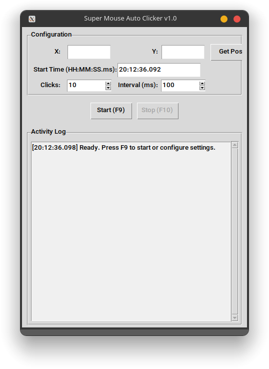

# PrecisionClick ⚡

> **High-Precision Desktop Automation Engine**  
> A robust, modular Python utility for millisecond-accurate mouse automation. Designed with a strict Separation of Concerns (SoC), leveraging hybrid timing strategies to bypass OS scheduler limitations while maintaining minimal CPU footprint.



---

## 🏗 Architecture & Design Philosophy

This project adheres to **SOLID principles** and **Clean Code** standards, prioritizing maintainability and testability over quick hacks. The architecture decouples business logic from presentation, enabling headless testing and future extensibility.

### Core Components

| Module | Responsibility | Pattern |
| :--- | :--- | :--- |
| `src/core/mouse.py` | Hardware Abstraction Layer (HAL). Wraps `pynput` for deterministic input simulation. | Adapter |
| `src/core/engine.py` | Business Logic. Orchestrates timing sequences using a hybrid Sleep/Spin-wait strategy. | Strategy / State Machine |
| `src/ui/main_window.py` | Presentation Layer. Manages Tkinter widgets and thread-safe UI updates via callbacks. | MVC / Observer |
| `src/main.py` | Entry Point. Initializes context and manages application lifecycle. | Facade |

### The "Hybrid Timing" Advantage
Standard `time.sleep()` in Windows/Linux has ~15ms granularity due to OS scheduler ticks. To achieve sub-millisecond precision without burning 100% CPU:
1.  **Coarse Phase:** Uses `time.sleep()` for the bulk of the wait duration (CPU efficient).
2.  **Fine Phase:** Switches to a tight **busy-wait loop** (`while datetime.now() < target`) for the final <2ms window (Maximum accuracy).

---

## ✨ Key Features

- **Sub-Millisecond Accuracy:** Achieves ±1-3ms deviation through hybrid scheduling algorithms.
- **Thread-Safe Execution:** Background worker threads prevent UI freezing during long sequences.
- **Real-Time Telemetry:** Integrated console logs every action with microsecond timestamps for audit trails.
- **Global Hotkeys:** Instant control via `F9` (Start/Pause) and `F10` (Stop/Reset).
- **Portable Build:** Compiled into a single standalone `.exe` via PyInstaller (No runtime dependencies).
- **Type-Safe Codebase:** 100% coverage with PEP 484 Type Hints and Google-style Docstrings.

---

## 🛠 Tech Stack

- **Language:** Python 3.11+
- **GUI Framework:** Tkinter (Native, Lightweight, Zero-Bloat)
- **Input Simulation:** Pynput (Cross-platform low-level API)
- **Build Tool:** PyInstaller (Single-file executable generation)
- **CI/CD:** GitHub Actions (Automated Windows Builds & Linting)
- **Quality Assurance:** Ruff (Linting), Black (Formatting), MyPy (Static Analysis)

---

## 📦 Installation & Usage

### Option 1: End-User (Binary)
Download the latest release from the [Releases Page](https://github.com/mohammad-hussein-dev/precision-click/releases).

1. Extract `PrecisionClick.exe`.
2. Run directly on Windows 10/11.
3. *Note: If Windows Defender flags the unsigned binary, select "More info" → "Run anyway". This is standard behavior for self-contained PyInstaller executables.*

### Option 2: Developer (Source)
Clone and run locally for customization or contribution.

```bash
# Clone repository
git clone https://github.com/mohammad-hussein-dev/precision-click.git
cd precision-click

# Create isolated virtual environment
python -m venv .venv
source .venv/bin/activate  # Linux/macOS
# .venv\Scripts\activate   # Windows

# Install dependencies in editable mode
pip install -e ".[dev]"

# Launch application
python -m src.main
```

---

## 🧪 Development Workflow

We enforce strict code quality gates via pre-commit hooks and CI pipelines to ensure production readiness.

### Running Tests & Linters
```bash
# Static Analysis & Formatting
ruff check . --fix
black .

# Type Checking
mypy src/

# Unit Tests
pytest tests/ -v --cov=src
```

### Building Executable Locally
```bash
pyinstaller --onefile --windowed --name PrecisionClick src/main.py
# Output located in ./dist/PrecisionClick.exe
```

---

## 📂 Project Structure

```text
precision-click/
├── .github/workflows/      # CI/CD Pipelines (Build & Lint)
├── assets/                 # Screenshots & Media Resources
├── docs/                   # Additional Technical Documentation
├── src/                    # Source Code Root
│   ├── core/               # Business Logic & HAL
│   │   ├── engine.py       # Timing Orchestration
│   │   └── mouse.py        # Input Simulation
│   ├── ui/                 # Presentation Layer
│   │   └── main_window.py  # Tkinter Controller
│   └── main.py             # Application Entry Point
├── tests/                  # Unit & Integration Tests
├── pyproject.toml          # Modern Python Project Config (PEP 621)
├── LICENSE                 # MIT License
└── README.md               # Project Documentation
```

---

## 🤝 Contributing

Contributions are welcome! Please follow these steps to maintain code integrity:

1. Fork the repository.
2. Create a feature branch (`git checkout -b feat/amazing-feature`).
3. Commit changes following [Conventional Commits](https://www.conventionalcommits.org/) (e.g., `feat: add new hotkey`).
4. Push to the branch (`git push origin feat/amazing-feature`).
5. Open a Pull Request.

Ensure all checks pass in CI before requesting review.

---

## 📄 License

Distributed under the MIT License. See [`LICENSE`](LICENSE) for more information.

---

<div align="center">

**Developed by Mohammad Hussein Ghafoori**  
*Senior Software Architect | DevSecOps Engineer*

[🌐 Portfolio](https://mohammad-hussein-dev.github.io/mohammad-hussein-dev/) • [💼 LinkedIn](https://www.linkedin.com/in/mohammad-hussein-dev/) • [🐙 GitHub](https://github.com/mohammad-hussein-dev) • [🦊 GitLab](https://gitlab.com/mohammad-hussein-dev) • [📧 Email](mailto:mohammad.hussein.dev.1@gmail.com)

</div>
